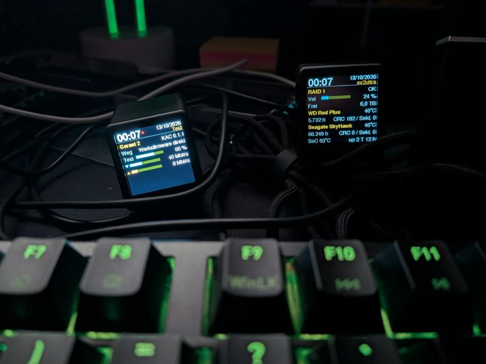
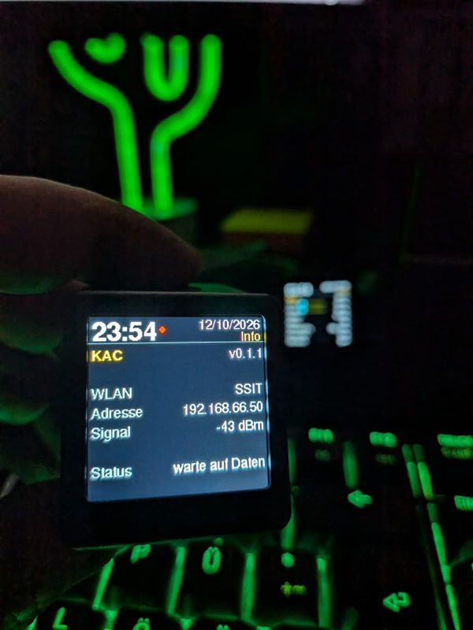
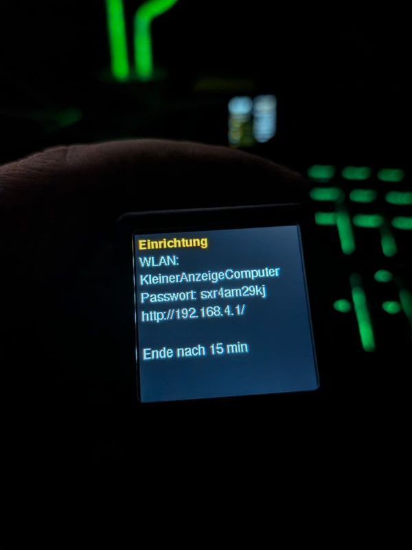

# KAC – KleinerAnzeigeComputer

Custom firmware for the **GeekMagic SmallTV Ultra** that turns the small cube display into a **status display
for your own dashboards**. A program on your network sends pages made of rows (headings, label/value pairs,
bar gauges), and the device shows them in rotation: flicker-free, with its own clock, and without an open
access point.

*KleinerAnzeigeComputer* is German for "little display computer". The device UI uses the short name **KAC**.
On the network each device calls itself `KleinerAnzeigeComputer-<chip ID>` (host name); its setup Wi-Fi is
`KAC-<chip ID>`. The chip ID is the last three bytes of the MAC address.

**The story behind it, with photos:** [KAC: A small cube becomes a status display for network, firewall and NAS](https://www.bk99.de/en/blog/2026/kac/)
on bk99.de ([German version](https://www.bk99.de/blog/2026/kac/)). The device's built-in guide page links there via QR code.

<p align="center"></p>

**Contents**

1. [Overview](#1-overview)
2. [Hardware](#2-hardware)
3. [How it works](#3-how-it-works)
4. [Installation](#4-installation)
5. [Wi-Fi setup](#5-wi-fi-setup)
6. [API](#6-api)
7. [Building a dashboard](#7-building-a-dashboard)
8. [Building and updating the firmware](#8-building-and-updating-the-firmware)
9. [Troubleshooting](#9-troubleshooting)
10. [Limits](#10-limits)
11. [License](#11-license)

---

## 1. Overview

```
 ┌───────────────────────┐   POST /api/seiten (JSON, every n s)  ┌───────────────────────────┐
 │ Your program          │ ────────────────────────────────────▶ │ KAC (SmallTV Ultra)       │
 │ (Python, shell, ...)  │        header X-Token                 │ - stores up to 3 pages    │
 │ collects metrics      │ ◀──────────────────────────────────── │ - rotates every rot s     │
 └───────────────────────┘        {"ok":true,"seiten":3}         │ - redraws changes only    │
                                                                 │ - clock/date via NTP      │
                                                                 └───────────────────────────┘
```

| Feature | Implementation |
|---|---|
| No access point in normal operation | The device is a Wi-Fi client only. |
| Setup | Cut the power 3 times in a row → Wi-Fi `KAC-<chip ID>` with a **random password shown only on the display**. |
| Flicker-free | Each row is fully drawn in memory and transferred in one piece; only rows that changed are redrawn. |
| Clock and date | Set by the device itself via NTP; time zone configurable (default Europe/Berlin). |
| Protected | Data and firmware updates require a per-device key, created by the device itself. |
| Ready-made image | Download, upload via the factory update page, done – or build it yourself. |
| Over-the-air updates | `http://<device>/update` |

The API field names are German (`seiten` = pages, `z` = rows, …); they are explained in [chapter 6](#6-api).

## 2. Hardware

GeekMagic SmallTV Ultra (also sold as "SmallTV"): ESP8266 (ESP-12F, 4 MB flash, about 80 KB RAM), 240×240 IPS
display with an ST7789 controller. The USB-C port only supplies power; a serial port is only available via
solder pads inside the case.

| Function | GPIO | Note |
|---|---|---|
| SPI clock | 14 | hardware SPI, SPI mode 3, 40 MHz |
| SPI data (MOSI) | 13 | |
| Chip select | – | not connected |
| Display DC | 0 | |
| Display reset | 2 | |
| Backlight | 5 | PWM, **inverted** (LOW = bright) |

Color order BGR, colors inverted. Pinout source: ESPHome device page "GeekMagic Ultra".

## 3. How it works

### 3.1 Boot sequence

```
Power on
   │
   ├─ boot counter in flash +1
   │     └─ 3 boots in a row, each shorter than 10 s?  ──yes──▶ setup mode (chapter 5)
   │
   ├─ no Wi-Fi stored yet?                             ──yes──▶ setup mode
   │     (on the very first boot KAC takes over a Wi-Fi network stored in the
   │      ESP8266 system area, if there is one)
   │
   └─ normal operation
         ├─ no device key yet? create a random one (8 characters) and store it
         ├─ access point permanently off (also in the ESP8266 system settings)
         ├─ connect to the stored Wi-Fi, then reconnect automatically
         ├─ time via NTP (pool.ntp.org, time.cloudflare.com)
         └─ web server: /api/seiten, /api/status, /update
```

Once the device has been running for more than 10 seconds, the boot counter is reset to 0, so a normal restart
never triggers setup.

### 3.2 Screen layout

```
 y=0   ┌────────────────────────────────────┐
       │ 23:05 ●                 12/10/2026 │  header: clock, status dot, date,
       │                           Internet │          page title (orange)
 y=35  ├────────────────────────────────────┤
 y=38  │ row 0                              │  8 rows of 25 px each
       │ row 1                              │
       │ ...                                │
 y=213 │ row 7                              │
 y=240 └────────────────────────────────────┘
```

- **Status dot (red)** next to the clock: no Wi-Fi, or no new data for 3 minutes.
- **Built-in pages** without dashboard data: until the first data arrives, and again after 10 minutes without
  data, the device rotates two pages of its own instead of stale values:
  - **Device**: version and chip ID, IP address, Wi-Fi, signal (dBm, red below −85), clock sync, uptime, time
    since the last data and – until data has arrived once – the **device key** (afterwards free RAM).
  - **Guide**: a QR code to the build guide at https://www.bk99.de/blog/2026/kac/ (German, English version linked).
- The date format is DD/MM/YYYY.

| Info page (no data yet, version 0.1.x) | Setup screen |
|---|---|
|  |  |

*Photos of early versions (0.1.x): since then the device texts are English, the info page became the Device and Guide pages,
the setup Wi-Fi is called `KAC-<chip ID>`, and the empty part of the bars is grey instead of olive.*

### 3.3 Row types

| `y` | Appearance | Fields |
|---|---|---|
| `h` | **Heading**: label bold orange on the left, value white on the right | `l`, `v`, `a` |
| `k` | **Label/value**: label grey on the left, value white on the right | `l`, `v`, `a` |
| `d` | **Down bar**: blue ▼ arrow, bar, value on the right (e.g. download) | `p`, `v`, `a` |
| `u` | **Up bar**: orange ▲ arrow, bar, value on the right (e.g. upload) | `p`, `v`, `a` |
| `b` | **Labeled bar**: label on the left, blue bar, value on the right (e.g. CPU) | `l`, `p`, `v`, `a` |
| `-` | empty row | – |

- `l` = label, `v` = value, `p` = bar fill 0–100 (percent)
- `a` = 1 → **alert**: the value (for headings also the label) or the bar turns **red**

### 3.4 Flicker-free drawing

The device remembers what each of the 8 rows shows. About four times per second it compares the requested
content with what is on screen:

1. Unchanged rows are **not** touched.
2. A changed row is drawn completely into an off-screen buffer (sprite, 8-bit color) and then copied to the
   display **in one piece**. There is no visible clearing.
3. The header is only redrawn when the time, date, title or status changes.

You can therefore send data very often (tested: every second) without any flicker.

### 3.5 Page rotation

Up to **3 pages**. Which page is shown depends on the wall clock:
`page = (Unix time / rot) mod count`. With `rot = 30` and 2 pages, page 1 appears on the full minute and page 2
on the half minute. Your program does not have to control the rotation; it just sends all pages.

### 3.6 Brightness

The device dims itself at night, also without any dashboard: brightness by day and at night and the night
hours (local time, see the time zone) are settings, by default 90 %, 10 % and 23:00–07:00. Set them on the setup
page or with the API fields `hell_tag`, `hell_nacht`, `nacht_von`, `nacht_bis`; they are written to flash only when
they change, so a dashboard can send them with every update. A brightness sent as `b` overrides the schedule as
long as the dashboard keeps sending (up to 10 minutes after the last data).

### 3.7 Security

| What | Protection |
|---|---|
| Wi-Fi in normal operation | client only, no access point |
| Setup Wi-Fi | only after the power-cycle gesture or if no Wi-Fi is stored; WPA2 with a 10-character random password shown only on the display; ends after 15 minutes |
| Device key | created randomly by each device on first start, stored in flash; shown on the setup screen, on the setup page (where you can set your own, 1–32 printable characters) and on the Device page until the first data has arrived; changeable via `POST /api/schluessel` with the current key |
| Sending data | header `X-Token` with the device key, otherwise `403` |
| Firmware update | HTTP Basic auth `admin` / device key, otherwise `401` |
| `GET /api/status` | no authentication, contains no secrets |

The connection is plain HTTP, so the device belongs in a separate network (IoT VLAN). The Wi-Fi password is
stored in the device's flash; anyone with physical access to the device can read it.

## 4. Installation

You can either **flash the ready-made image** or **build the firmware yourself** (chapter 8). Both give the
same result; the image contains no secret, every device creates its own key.

| Starting point | Path |
|---|---|
| **GeekMagic factory firmware** | upload the image via its update page, see below |
| **KAC already installed** | `/update` with user `admin` and the device key, see chapter 8 |
| Device no longer boots | serial: open the case, hold GPIO0 to GND at power-on, `esptool.py write_flash 0x0 firmware.bin` |

### 4.1 Flash the ready-made image (no compiler needed)

1. Download the latest image from [`firmware/`](firmware/), e.g.
   [kac-0.5.0.bin](https://github.com/GiT-BeDa/KleinerAnzeigeComputer/raw/main/firmware/kac-0.5.0.bin), and check its MD5
   (`a1796b1dd80d08960d2835a6be20f83e` for 0.5.0, all values in [`firmware/README.md`](firmware/README.md)).
2. Find the device's address in your router (the factory firmware also shows it on the display) and open
   `http://<device>/update`.
3. Choose the file in the **firmware** field (not "filesystem") and click **Update**, or use curl:
   ```sh
   curl -F "firmware=@kac-0.5.0.bin" http://<device>/update
   # → "Update Success! Rebooting..."
   ```
4. The device restarts with KAC and shows **"Setup"**: continue with chapter 5, steps 2–5. Write down the
   **device key** shown there; your dashboard needs it.

Tested with factory firmware Ultra-V9.0.51. It works because KAC is built exactly like the factory image
(Arduino ESP8266 core, same eboot bootloader, DIO, 4 MB, 40 MHz). The image has to fit into the free space next
to the factory firmware, roughly 500 KB; KAC needs about 390 KB. If the upload is rejected
("Not Enough Space"), nothing has changed.

The factory firmware keeps its Wi-Fi settings in its own file system, which KAC does not read, so you enter
the Wi-Fi once more. KAC does not touch that file system either: the factory firmware including its settings
can be restored later by uploading the factory image (available from GeekMagic on GitHub) via KAC's `/update`.

### 4.2 Build it yourself

See chapter 8. No key is needed for building.

## 5. Wi-Fi setup

1. **Disconnect and reconnect the power 3 times in a row.** Let it run for a few seconds each time, but
   **less than 10 seconds**. (Not needed right after installing: without stored Wi-Fi, setup starts by itself.)
2. The display shows **"Setup"**, the Wi-Fi name `KAC-<chip ID>` (e.g. `KAC-4670fa`), a **password** and the
   **device key**.
3. Connect to this Wi-Fi and open `http://192.168.4.1/`.
4. Pick your network from the list (or type its name) and enter its password. Optionally set the time zone as
   a POSIX TZ string (default `CET-1CEST,M3.5.0,M10.5.0/3` = Europe/Berlin), the brightness by day/at night
   with the night hours, and your own **device key**
   (1–32 printable characters; empty keeps the current one). **Save**. To change only the time zone or the
   key, leave the Wi-Fi password empty: the stored one is kept for the same network.
5. The device restarts and connects. The access point is off again. Until the first data arrives, the info
   page shows the device key once more.

Without input, setup ends after **15 minutes** with a restart. The setup page also offers the firmware update as
a rescue path in case of broken firmware.

## 6. API

### `POST /api/seiten`

| | |
|---|---|
| Headers | `X-Token: <device key>`, `Content-Type: application/json` |
| Body | JSON, at most 4096 bytes |

```jsonc
{
  "b": 90,                       // brightness 0..100, overrides the schedule   (optional)
  "hell_tag": 90, "hell_nacht": 10,      // schedule: brightness by day/at night   (optional, stored on change)
  "nacht_von": 23, "nacht_bis": 7,       //           night hours, local time
  "rot": 30,                     // seconds per page, 5..255        (optional, default 30)
  "tz": "CET-1CEST,M3.5.0,M10.5.0/3",  // POSIX time zone             (optional, stored only when changed)
  "seiten": [                    // pages, 1..3
    {
      "t": "Internet",           // page title, up to 15 characters
      "z": [                     // rows, up to 8, top to bottom
        {"y": "h", "l": "Fiber", "v": "8 / 10 ms"},
        {"y": "d", "p": 12, "v": "12 Mbit/s"},
        {"y": "u", "p": 3,  "v": "1.2 Mbit/s"},
        {"y": "-"},
        {"y": "k", "l": "Clients 34", "v": "VPN 25 ms", "a": 1},
        {"y": "b", "l": "CPU", "p": 18, "v": "18 %"}
      ]
    }
  ]
}
```

| Field | Meaning |
|---|---|
| `b` | brightness (overrides the schedule) |
| `hell_tag`, `hell_nacht`, `nacht_von`, `nacht_bis` | brightness schedule: day %, night %, night from/to hour (chapter 3.6) |
| `rot` | rotation interval |
| `tz` | time zone (POSIX TZ string) |
| `seiten` | pages |
| `t` | page title |
| `z` | rows (*Zeilen*) |
| `y` | row type (chapter 3.3) |
| `l`, `v`, `p`, `a` | label, value, percent, alert |

| Response | Meaning |
|---|---|
| `200 {"ok":true,"seiten":n}` | accepted, `n` pages stored |
| `400 {"error":"size"}` | empty or larger than 4096 bytes |
| `400 {"error":"json","detail":...}` | invalid JSON |
| `403 {"error":"token"}` | key missing or wrong |

Every update **replaces all pages**. Missing rows are empty.

### `GET /api/status`

```json
{"name":"KleinerAnzeigeComputer-4670fa","version":"0.2.1","uptime":3600,"ssid":"MyWiFi","rssi":-45,"heap":33800,
 "seiten":3,"seite":1,"daten_alter_s":4,"zeit":1791838000,"tz":"CET-1CEST,M3.5.0,M10.5.0/3",
 "hell":10,"hell_tag":90,"hell_nacht":10,"nacht_von":23,"nacht_bis":7}
```

`daten_alter_s` = seconds since the last update (−1: never), `seite` = page currently shown (−1: built-in Device page, −2: built-in Guide page),
`zeit` = device time (Unix).

### `POST /api/schluessel`

Changes the device key. Header `X-Token: <current key>`; body `{"key":"<new key>"}` (1–32 printable characters,
no spaces) or `{}` for a new random key. Answer `{"ok":true,"key":"<new key>"}`; the new key applies at once to the
data API and the firmware update.

### `GET|POST /update`

Firmware update (chapter 8).

## 7. Building a dashboard

A dashboard is a small program that regularly collects values, builds pages from them and sends them to the
device:

```
every n seconds:
   collect values  →  build pages as JSON  →  POST /api/seiten  →  on error: carry on
```

### 7.1 Designing pages

Each page has **8 rows**. The font is proportional. As a rule of thumb, **label + value together fit about
24 characters** per row, and bar rows leave **about 10 characters** for the value. Texts are cut after
27 bytes.

Good practice:

- **Heading (`h`) as a group header**, with the most important value on the right (e.g. temperature, latency).
- **Bars (`d`/`u`/`b`)** for anything with an upper limit (bandwidth, CPU, disk usage). Compute `p` yourself:
  `round(value * 100 / maximum)`.
- **Label/value (`k`)** for plain figures.
- **`a: 1`** only for real problems, so that red stands out.
- **No repetition** across pages. The clock is always in the header anyway.
- **Character set:** ASCII plus `°` only. Umlauts, `·`, `–`, arrows and emojis are not displayed.

### 7.2 Minimal example with `curl`

```sh
curl -s -X POST http://<device>/api/seiten -H "X-Token: $KAC_TOKEN" -H 'Content-Type: application/json' \
  -d '{"seiten":[{"t":"Test","z":[{"y":"h","l":"Hello","v":"World"},{"y":"b","l":"CPU","p":42,"v":"42 %"}]}]}'
```

### 7.3 Minimal example in Python

```python
import json, os, time, urllib.request

DEVICE = "http://192.168.1.50"           # address of the KAC
TOKEN = os.environ["KAC_TOKEN"]          # device key, never store it in the code

def load():                              # example value: system load in %
    return min(100, os.getloadavg()[0] * 100 / os.cpu_count())

def send(pages, brightness=80):
    body = json.dumps({"b": brightness, "rot": 30, "seiten": pages}).encode()
    req = urllib.request.Request(DEVICE + "/api/seiten", body,
                                 {"X-Token": TOKEN, "Content-Type": "application/json"})
    urllib.request.urlopen(req, timeout=10).read()

while True:
    l = load()
    page = {"t": "Server", "z": [
        {"y": "h", "l": os.uname().nodename, "v": time.strftime("%H:%M:%S")},
        {"y": "b", "l": "Load", "p": round(l), "v": "%d %%" % l, "a": int(l > 90)},
    ]}
    try:
        send([page])
    except Exception as e:               # device briefly unreachable: just carry on
        print("error:", e)
    time.sleep(5)
```

### 7.4 Update rate

| What | Recommendation |
|---|---|
| Fast values (throughput, CPU) | every 1–10 s, no flicker |
| Slow values (temperatures, SMART, counters) | query every 30–60 s and cache, but include them in every update |
| Program stops | after 3 minutes without data the red status dot appears; the last values stay on screen |

The device writes **nothing to flash** when receiving data, so frequent updates cause no wear.

### 7.5 Running it as a service (systemd)

`tools/kac-dashboard.service` is a ready-made unit: copy the repository to `/opt/kac`, the configuration to
`/etc/kac/kac.env` (mode 600), then `systemctl enable --now kac-dashboard.service`. For your own script,
the same pattern applies: credentials in a file with mode 600 (`EnvironmentFile=` or your own parser),
`Restart=always`, `ProtectSystem=strict`.

### 7.6 Complete example: `tools/kac_dashboard.py`

A production dashboard for an **OPNsense** firewall and a **Linux NAS**, with up to three pages:

| Page | Content | Source |
|---|---|---|
| **Internet** | clients, VPN latency, today's traffic; per uplink IPv4/IPv6 latency and down/up bars | OPNsense API (traffic, gateway RRD, ARP) |
| **Firewall** | CPU temperature, CPU, RAM, states, new connections/s, source/destination IPs, processes, blocked packets/h | OPNsense system health RRDs |
| **NAS** (optional) | RAID status, usage, per disk temperature, power-on hours, CRC errors, bad sectors | SSH + `smartctl` (read-only) |

Configuration file (`KEY=value`, default `/root/.config/kac/kac.env`, other path via `KAC_CONFIG`):

| Key | Meaning | Example |
|---|---|---|
| `OPNSENSE_URL`, `OPNSENSE_KEY`, `OPNSENSE_SECRET` | firewall API (required) | `https://192.168.1.1` |
| `KAC_TOKEN` | device key of the display (required; shown on its setup screen) | |
| `TV_URL` | KAC device | `http://192.168.1.50` |
| `LINES` | uplinks: `name:interface:max_down:max_up:gw_v4,gw_v6`, separated by `;` | `Fiber:opt1:100:40:FIBER_GW,FIBER_GW6;DSL:wan:100:40:WAN_GW,WAN_GW6` |
| `VPN_GATEWAY` | gateway for the VPN latency (optional) | `WG_GW` |
| `NO_CLIENT_IFACES` | ARP interfaces that do not count as clients | `WAN,Fiber` |
| `FW_TITLE`, `NAS_TITLE` | page titles | `Firewall`, `NAS` |
| `NAS_SSH`, `NAS_KNOWN_HOSTS`, `NAS_DISKS`, `NAS_MOUNT` | NAS via SSH (empty `NAS_SSH`: no NAS page) | `root@nas`, `sda sdb`, `/mnt/data` |
| `INTERVALL`, `LANGSAM`, `ROT_S` | seconds: fast values, slow values, page rotation | `5`, `60`, `30` |
| `TZ` | time zone sent to the device (optional) | `EST5EDT,M3.2.0,M11.1.0` |
| `HELL_TAG`, `HELL_NACHT`, `NACHT_VON`, `NACHT_BIS` | brightness schedule sent to the device (it dims by itself) | `90`, `10`, `23`, `7` |

Worth noting:

- Rates (Mbit/s) are the **difference of two byte counters** divided by the elapsed time.
- `max_down`/`max_up` should be the narrowest point of the line (sync rate or traffic shaper), so a full
  bar really means "saturated".
- The OPNsense API user needs **read privileges only**: "Reporting: Traffic", "Diagnostics: System Health",
  "Diagnostics: ARP Table".
- Credentials live only in the configuration file, never in the code.

## 8. Building and updating the firmware

```sh
pip install platformio
pio run                                   # image: .pio/build/smalltv/firmware.bin
curl -u "admin:<device key>" -F "firmware=@.pio/build/smalltv/firmware.bin" http://<device>/update
```

- The build needs no key; every device creates its own on first start and keeps it across updates.
- Optional, for your own fleet: `KAC_TOKEN=<key> pio run` builds an image that uses `<key>` as the **initial**
  key on devices that have none yet. Such an image contains the key – do not publish it.
- The Wi-Fi settings, time zone and key survive updates; they live in a separate flash sector.
- Version: `-DKAC_VERSION` in `platformio.ini`. Ready-made images go to `firmware/` with their checksums.

## 9. Troubleshooting

| Observation | Cause / remedy |
|---|---|
| Red dot next to the clock | no Wi-Fi or no data for 3 min: check your program and the network, `GET /api/status` |
| Clock shows `--:--` | no NTP response yet; allow DNS/NTP in the network |
| Device/Guide pages instead of your pages | no data for 10 min (or never): program not running, wrong key (`403`) or wrong address |
| `403` when sending | `X-Token` wrong or missing |
| Device key forgotten | power-cycle gesture (chapter 5): the setup screen and page show it, and you can set a new one |
| `400 json` | invalid JSON (e.g. comments included) |
| Characters missing | only ASCII and `°` are displayed |
| Text cut off or overlapping | shorten the text (chapter 7.1) |
| Device unreachable | setup via the power-cycle gesture (chapter 5), which also offers the firmware update |
| Keeps rebooting | if the firmware crashes within 10 s each time, 3 crashes in a row open the setup; upload working firmware there. Otherwise: power-cycle gesture |

## 10. Limits

- 3 pages × 8 rows, texts up to 27 bytes, titles up to 15 bytes, JSON up to 4 KB.
- No graphics or images, no free choice of colors (normal/alert only).
- No HTTPS (the ESP8266 has too little memory for it).

## 11. License

GPL-3.0, see [LICENSE](LICENSE). Libraries used: TFT_eSPI (Bodmer, FreeBSD/MIT parts), ArduinoJson (MIT),
Arduino core for ESP8266 (LGPL-2.1). Pinout from the ESPHome device page "GeekMagic Ultra".
